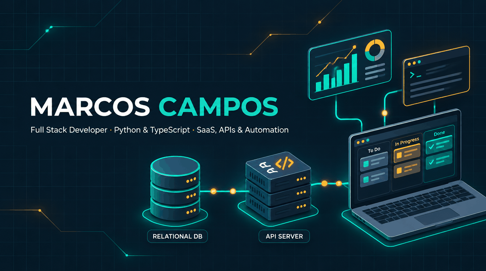

<h1 align="center">Marcos Campos</h1>

<b>Desenvolvedor Full Stack</b> · Python & TypeScript · SaaS, APIs e automação para negócios reais

---

### 🧭 Sobre mim

Construo aplicações **ponta a ponta**: da modelagem do banco e da API até a interface que o usuário final realmente usa.

Meu foco são **produtos de software para pequenas e médias empresas** — CRMs operacionais, plataformas SaaS de gestão, automação fiscal e integrações com sistemas externos. Projetos que precisam funcionar em produção, não só no `localhost`.

- 🔭 Atualmente desenvolvendo plataformas SaaS de gestão e automação de processos fiscais
- 🧱 Backend em **Python (Flask)** e **Java (Spring Boot)**; frontend em **TypeScript**, JavaScript, HTML5 e CSS3
- 🗄️ Modelagem relacional, SQL avançado (JOINs, agregações, views) e integrações via API REST
- 🤖 Uso IA generativa como acelerador no desenvolvimento — sempre com revisão, teste e refatoração do que é gerado
- 🤝 Aberto a colaborações e a trocar ideias sobre arquitetura, boas práticas e engenharia de software

---

### 🛠️ Stack

**Frontend**

**Backend**

**Dados & Infra**

---

### 📌 Projetos em destaque

**Aplicações web full stack**

| Projeto | Descrição | Stack |
|---|---|---|
| [**TaskFlow**](https://github.com/marcoscamposbhargo/TaskFlow) | Sistema de gestão de tarefas estilo Kanban com atualização em tempo real entre usuários. | Flask · Flask-SocketIO · WebSockets |
| [**EcommerceSql**](https://github.com/marcoscamposbhargo/EcommerceSql) | Sistema web completo de analytics de e-commerce, com SQL avançado, agregações e CRUD. | Flask · SQLite · SQL |
| [**devpulse-kanban**](https://github.com/marcoscamposbhargo/devpulse-kanban) | Aplicação web interativa de Kanban e gestão de projetos. | HTML5 · CSS3 · JavaScript |
| [**NexusWorkspace**](https://github.com/marcoscamposbhargo/NexusWorkspace) | Workspace de gerenciamento dinâmico com backend Python e interface web. | Python · JS · HTML · CSS |

**APIs & backend**

| Projeto | Descrição | Stack |
|---|---|---|
| [**JavaBank**](https://github.com/marcoscamposbhargo/JavaBank) | API REST de gerenciamento de contas bancárias com persistência relacional. | Java · Spring Boot · H2 |
| [**task-manager-api**](https://github.com/marcoscamposbhargo/task-manager-api) | API REST de gerenciamento de tarefas. | REST |
| [**cryptofinance-ecosystem**](https://github.com/marcoscamposbhargo/cryptofinance-ecosystem) | Plataforma de simulação de carteira (portfolio tracker) de criptoativos. | Java |

**Automação & ferramentas de desenvolvimento**

| Projeto | Descrição | Stack |
|---|---|---|
| [**DevCockPit**](https://github.com/marcoscamposbhargo/DevCockPit) | Central local de projetos: descobre repositórios, identifica a stack e integra Git e Docker. | Python · Docker |
| [**ZapCRMLocal**](https://github.com/marcoscamposbhargo/ZapCRMLocal) | Mini CRM desktop para gerenciamento automatizado de conversas de WhatsApp. | Python · Flask |
| [**python-smart-scraper**](https://github.com/marcoscamposbhargo/python-smart-scraper) | Robô de monitoramento de preços em e-commerce, com histórico e alertas. | Python · SQLite |
| [**tokensmonitor**](https://github.com/marcoscamposbhargo/tokensmonitor) | Monitor em tempo real de consumo de tokens do Claude Code. | JavaScript |

---

### 📊 Estatísticas

