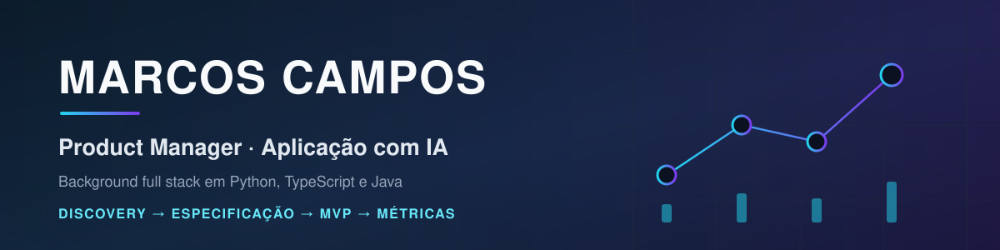

<h1 align="center">Marcos Campos</h1>

<b>Product Manager · Aplicação com IA · Claude Code Expert</b> 
Background full stack em Python, TypeScript e Java — especifico, prototipo e levo o produto até produção

---

### 🎯 O que eu faço hoje

Atuo como **Product Manager com foco em aplicação com IA**: parto do problema de negócio, defino escopo, não-escopo e métricas de sucesso, e acompanho o produto até produção. O diferencial é técnico — escrevo a especificação e também o protótipo, o que encurta o ciclo entre hipótese e versão funcional.

- 🎯 **Produto:** descoberta com usuários, recorte de escopo, priorização e roadmap
- 🤖 **IA aplicada:** decidir onde um LLM resolve de fato o problema (e onde não resolve), desenhar o fluxo, avaliar a qualidade da saída e controlar custo por token
- **Claude Code:** uso diário em desenvolvimento e automação, incluindo ferramentas próprias construídas sobre ele
- 📐 **Especificação:** PRDs, critérios de aceite e modelagem de dados que engenharia consegue executar sem retrabalho
- 📊 **Métricas:** indicadores de ativação, uso e retenção — definidos antes do build e lidos para decidir o ciclo seguinte
- 🧱 **Execução técnica:** Python (Flask, FastAPI), TypeScript/React, PostgreSQL e Docker — protótipos e MVPs ponta a ponta
- 🧪 **Processo:** revisão de código, testes e refatoração contínua, inclusive sobre o que é acelerado por IA generativa
- 🔒 Parte dos produtos em que trabalho está em repositórios privados

---

### 🛠️ Stack

**Produto & IA**

**Backend**

**Frontend**

**Dados & Infra**

---

### 📌 Projetos públicos

**Aplicações web full stack**

| Projeto | O que resolve | Stack |
|---|---|---|
| [**TaskFlow**](https://github.com/marcoscamposbhargo/TaskFlow) | Gestão de tarefas estilo Kanban com atualização em tempo real entre usuários conectados. | Flask · Flask-SocketIO · WebSockets |
| [**EcommerceSql**](https://github.com/marcoscamposbhargo/EcommerceSql) | Analytics de e-commerce com SQL avançado, agregações e CRUD completo sobre base relacional. | Flask · SQLite · SQL |
| [**NexusWorkspace**](https://github.com/marcoscamposbhargo/NexusWorkspace) | Workspace de gestão dinâmica com backend Flask e empacotamento desktop. | Python · Flask · SQLite · Pywebview |
| [**devpulse-kanban**](https://github.com/marcoscamposbhargo/devpulse-kanban) | Kanban interativo de gestão de projetos, sem dependências de framework. | HTML5 · CSS3 · JavaScript |

**APIs & backend**

| Projeto | O que resolve | Stack |
|---|---|---|
| [**JavaBank**](https://github.com/marcoscamposbhargo/JavaBank) | API REST de contas bancárias em arquitetura em camadas (controller → service → repository), com validação de regras de saldo. | Java 21 · Spring Boot · JPA · H2/PostgreSQL |
| [**cryptofinance-ecosystem**](https://github.com/marcoscamposbhargo/cryptofinance-ecosystem) | Simulação de carteira (portfolio tracker) de criptoativos. | Java |

**Ferramentas & automação**

| Projeto | O que resolve | Stack |
|---|---|---|
| [**DevCockPit**](https://github.com/marcoscamposbhargo/DevCockPit) | Central local de projetos: descobre repositórios, identifica a stack, mostra Git e Docker e resolve conflito de porta sem abrir terminal. | Python · Docker · SQLite |
| [**tokensmonitor**](https://github.com/marcoscamposbhargo/tokensmonitor) | Janela flutuante que acompanha em tempo real o consumo de tokens do Claude Code em todas as sessões da máquina. | Electron · Node.js · JavaScript |
| [**ZapCRMLocal**](https://github.com/marcoscamposbhargo/ZapCRMLocal) | Mini CRM desktop para gerenciamento automatizado de conversas de WhatsApp. | Python · Flask · Playwright · SQLite |
| [**python-smart-scraper**](https://github.com/marcoscamposbhargo/python-smart-scraper) | Robô de monitoramento de preços em e-commerce, com histórico e alertas. | Python · SQLite |
| [**marketlab**](https://github.com/marcoscamposbhargo/marketlab) | Laboratório econômico interativo: modela mercados a partir de dados observáveis e demonstra oferta, demanda e elasticidade com gráficos. | Python |

---

### 📊 Métricas dos projetos

| Projeto | Linguagem principal | Último commit | Tamanho do código | Stars |
|---|---|---|---|---|
| [**TaskFlow**](https://github.com/marcoscamposbhargo/TaskFlow) |  |  |  |  |
| [**EcommerceSql**](https://github.com/marcoscamposbhargo/EcommerceSql) |  |  |  |  |
| [**NexusWorkspace**](https://github.com/marcoscamposbhargo/NexusWorkspace) |  |  |  |  |
| [**JavaBank**](https://github.com/marcoscamposbhargo/JavaBank) |  |  |  |  |
| [**DevCockPit**](https://github.com/marcoscamposbhargo/DevCockPit) |  |  |  |  |
| [**ZapCRMLocal**](https://github.com/marcoscamposbhargo/ZapCRMLocal) |  |  |  |  |
| [**python-smart-scraper**](https://github.com/marcoscamposbhargo/python-smart-scraper) |  |  |  |  |
| [**tokensmonitor**](https://github.com/marcoscamposbhargo/tokensmonitor) |  |  |  |  |
| [**marketlab**](https://github.com/marcoscamposbhargo/marketlab) |  |  |  |  |

Métricas lidas em tempo real da API do GitHub via shields.io.
